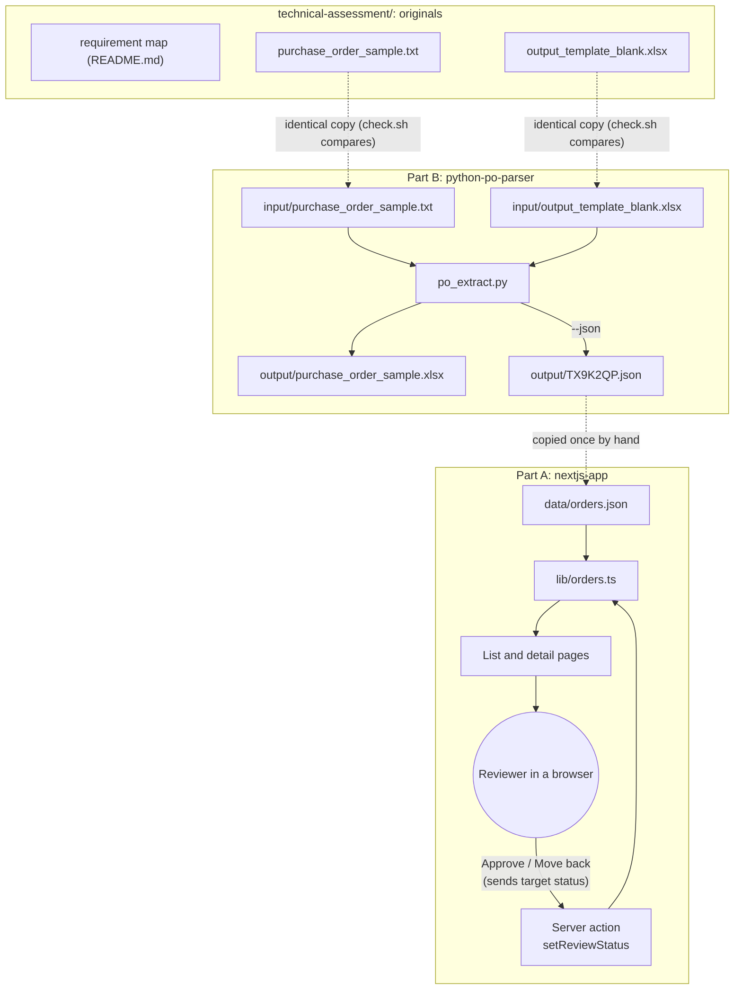
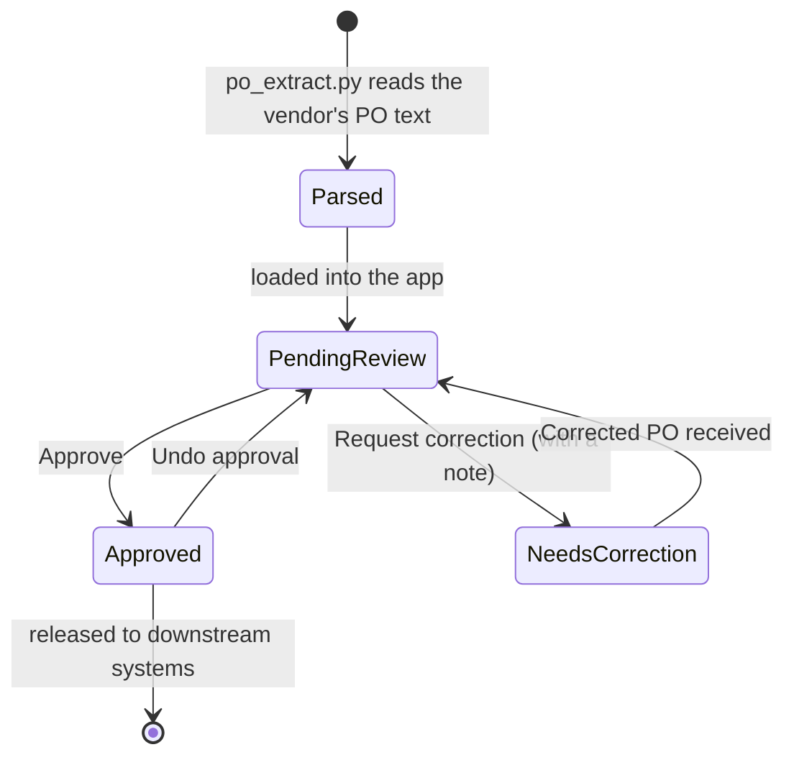
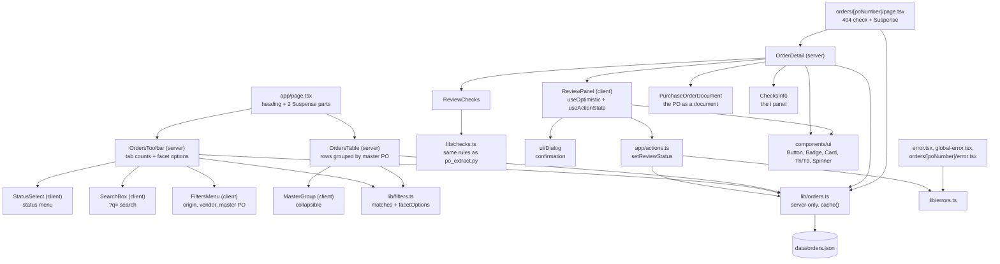
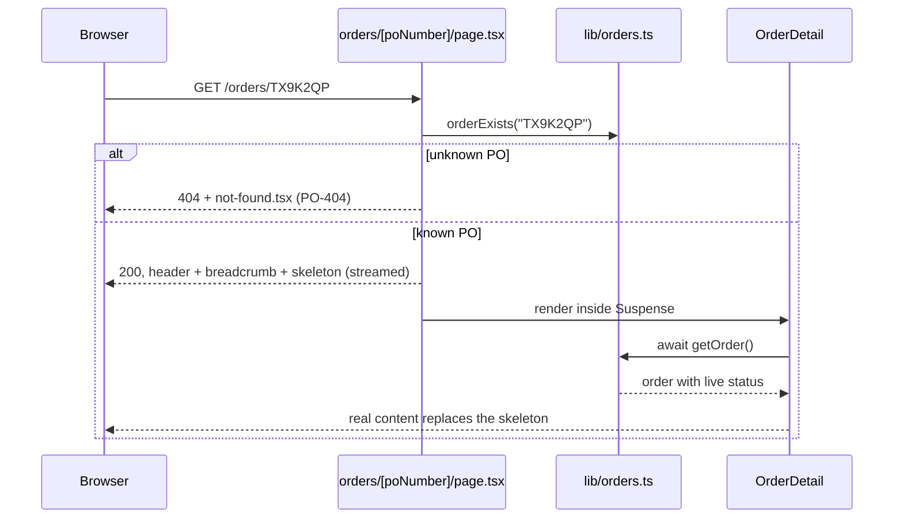
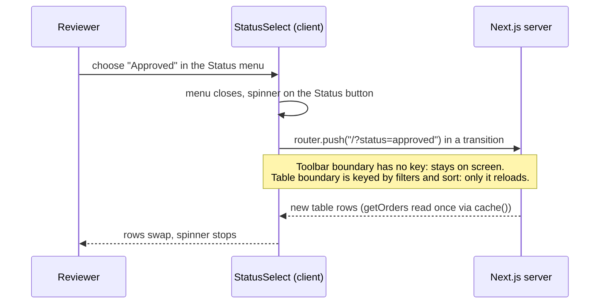
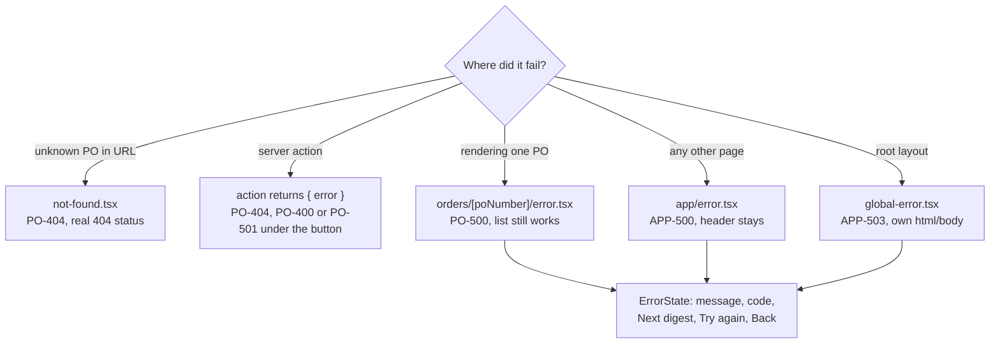
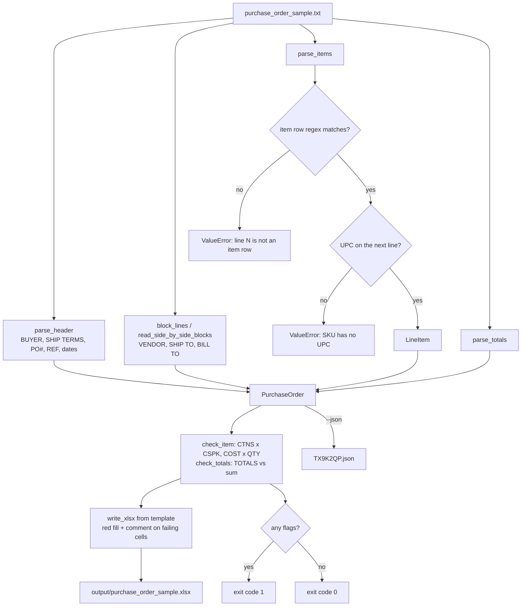
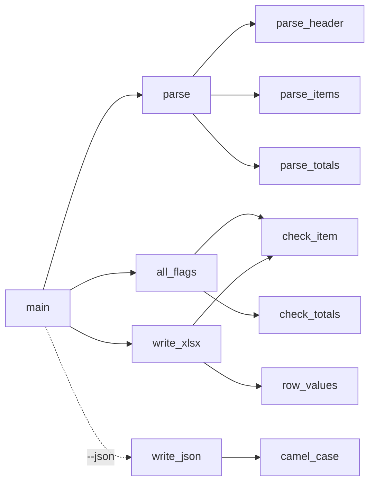
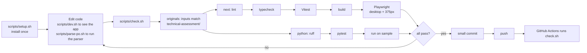

# Design notes

How the two parts fit together, how data and requests move through each one, and why it is built this way. Diagrams are Mermaid, so GitHub renders them.

## 1. System overview

Two independent programs and the original materials they were built from. Solid arrows are runtime data flow; dotted arrows are one-time copies or checks. The terminal scripts that run everything are in section 5.



## 2. Purchase order lifecycle

How a PO moves through review. A reviewer isn't refusing a purchase: if something is wrong they hold the PO and ask the vendor for a corrected one. Every arrow in the app asks for confirmation first.



Stored statuses (`ReviewStatus` in `lib/types.ts`): `pending`, `approved`, `needs_correction`. The correction note is kept only while a PO needs correction. Seven plain-language checks (`lib/checks.ts`) run on every PO; problems show in red on the PO page with what to do, and pre-fill the correction note.

## 3. Part A: nextjs-app

### Module graph

Arrows point from a module to what it uses. Only `lib/orders.ts` touches data.



### Page request lifecycle (first load)

The shell is sent at once; data parts stream in behind skeletons. The 404 check happens before anything is sent, so the status code is real.



### Server action lifecycle (Approve)

```mermaid
sequenceDiagram
  participant U as Reviewer
  participant BTN as ReviewPanel
  participant A as actions.ts
  participant O as lib/orders.ts
  U->>BTN: click Approve (or Request correction, Revoke, Corrected)
  BTN->>BTN: confirmation dialog (PO, vendor, total); person confirms
  BTN->>BTN: optimistic: badge and buttons change, spinner while saving
  BTN->>A: POST form data (poNumber)
  A->>O: orderExists(poNumber)
  alt unknown PO
    A-->>BTN: { error: PO-404 }
    BTN-->>U: React rolls the optimistic status back, error under the button
  else
    A->>O: setStatus(poNumber, target)
    alt save fails
      A-->>BTN: { error: PO-501 } (logged on server)
      BTN-->>U: React rolls the optimistic status back, error under the button
    else saved
      A->>A: revalidatePath("/") and ("/orders/po")
      A-->>BTN: {} + fresh page data in the same response
      BTN-->>U: server status now matches what is already on screen
    end
  end
```

### Status change lifecycle (only the table reloads)



### Error handling flow



### Decisions

| Decision | Choice | Why |
|---|---|---|
| Data | `data/orders.json`, 4 POs. TX9K2QP comes from the Python parser; the others are made-up sample data. | Realistic for BHF; no external API to fail. |
| Where status lives | In-memory `Map` on `globalThis`, seeded from JSON | No dependencies, works on Vercel's read-only filesystem. Resets on restart (stated in README). |
| Rendering | `dynamic = "force-dynamic"` on both pages | Status changes at runtime; a prerendered page would show stale status. |
| Data access | Only `lib/orders.ts` touches data, all async | Swapping in a database later is a one-file change. |
| Client code | Review panel, status tabs, error state | Everything else stays on the server. |
| Information order | Detail page: the review (status, button, steps, pass/fail checks) on top; the PO as a familiar document below | The decision comes first; the record is laid out the way buyers and vendors already read a PO. |
| Color | Amber = waiting, green = done or checks out, red = problem, blue = links, actions and share bars | Color carries meaning only, so it never competes with the data. |
| Set, not toggle | The button sends the status it wants; the server sets exactly that | Idempotent: a repeated click, a stale tab or two reviewers at once can't flip an approval back. |
| Partial reloads | Toolbar and table are separate `<Suspense>` parts; only the table is keyed by filters and sort | Changing a filter reloads only the rows. `cache()` makes both parts share one data read. |
| Faceted filters | Status as tabs; origin, vendor, master PO as facets; OR inside a facet, AND across; options limited to what returns results | People never pick a filter that empties the list by surprise; every view is a URL. |
| Hierarchy | POs grouped under master PO, collapsible; breadcrumb List / Master PO / PO | Mirrors how the POs relate on paper ("REF MASTER PO#"). |
| Errors | Codes and messages in `lib/errors.ts`; three error boundaries | A person sees a plain message and a code to quote; the action returns errors instead of throwing. |
| No `loading.tsx` | Skeletons come from `<Suspense>` inside the page | `loading.tsx` streamed a 200 before `notFound()` ran, so unknown POs lost their 404. |

## 4. Part B: python-po-parser

### Processing pipeline



### Call graph



### Decisions

| Decision | Choice | Why |
|---|---|---|
| Item rows | One anchored regex with named groups | Descriptions contain spaces and numbers are right-aligned; slicing by column is more fragile. |
| Unreadable rows | Any non-blank line in the table that is not an item raises with its line number | A row the regex can't read is never dropped silently. |
| UPC | Must be the next line (`^ {4}\d{12,14}$`), else raise | The UPC belongs to the row above; a missing one is an error, not a skip. |
| SHIP TO / BILL TO | Split each line at the column where "BILL TO" starts | The two blocks sit side by side. |
| IDs | Strings with Excel `@` format | Keeps leading zeros in UPC and Vendor Part #. |
| Money | `Decimal` for parsing and checks | Exact comparison, no float noise. |
| Total Cost | PO grand total (447,455.12) on every row | Header values repeat on every row; per-row cost is already EXT Cost. |
| Flags | Red fill and a comment on the failing cell, plus stdout and exit code 1 | The schema must match the template, so no extra columns. |

## 5. Terminal scripts, checks and delivery

Every script is in `scripts/`, works from any folder, and prints its options with `--help`. They share helpers in `scripts/_common.sh`.


