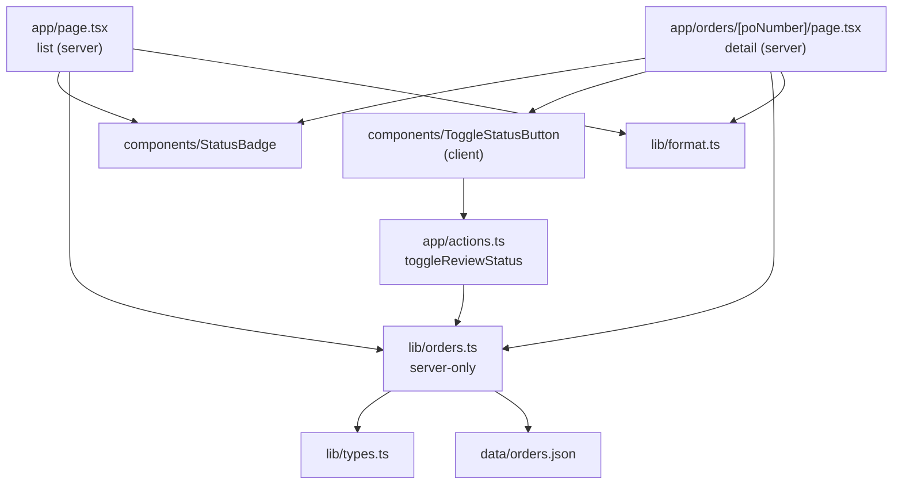
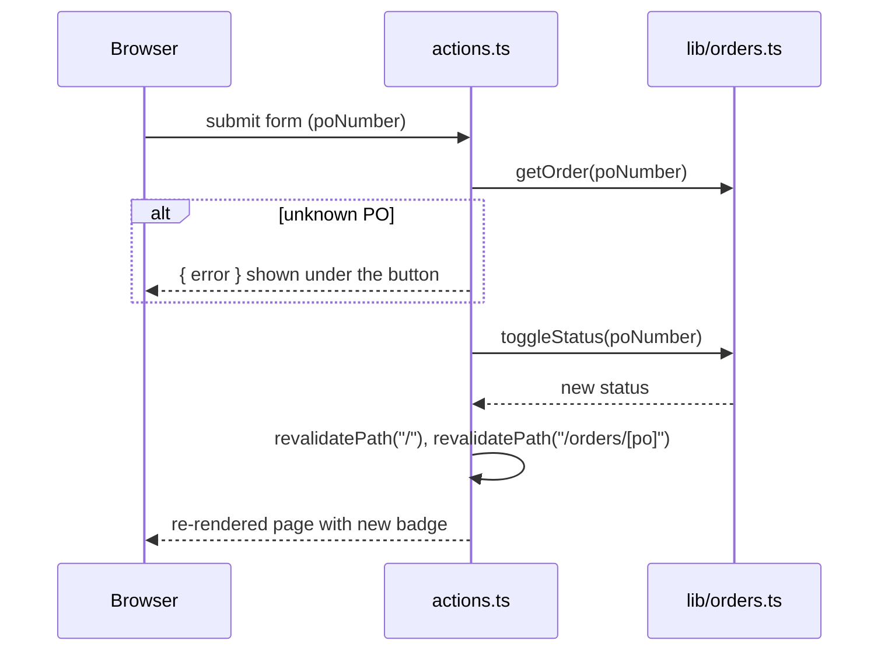
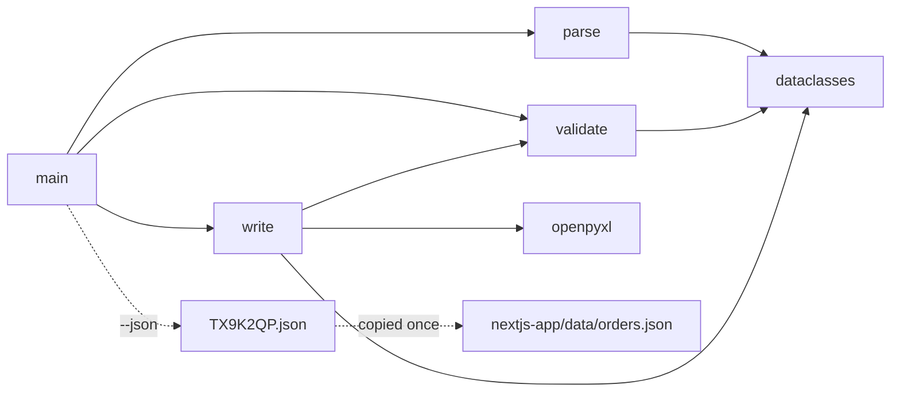
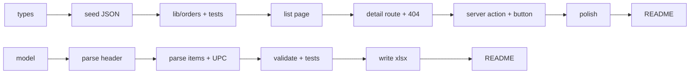

# Design notes

One page per part: what each module does, how they depend on each other, and the decisions behind them.

## Part A: nextjs-app

A reviewer opens a list of purchase orders, opens one to see its line items, and marks it **Approved** or back to **Pending review**.

Request flow for the server action:

| Decision | Choice | Why |
|---|---|---|
| Data | `data/orders.json`, 4 POs. TX9K2QP is transcribed from the Python sample; the others are made-up sample data. | Realistic for BHF; no external API to fail. |
| Where status lives | In-memory `Map` on `globalThis`, seeded from JSON | No dependencies, works on Vercel's read-only filesystem. Resets on restart (stated in README). |
| Rendering | `dynamic = "force-dynamic"` on both pages | Status changes at runtime; a prerendered page would show stale status. |
| Data access | Only `lib/orders.ts` touches data | Swapping in a database later is a one-file change. |
| Client code | One client component (the toggle button) | Everything else stays on the server. |
| No `loading.tsx` | Removed | Data comes from memory, so it never shows, and it made unknown POs return 200 instead of 404. |

## Part B: python-po-parser

| Decision | Choice | Why |
|---|---|---|
| Item rows | One anchored regex with named groups | Descriptions contain spaces and numbers are right-aligned; slicing by column is more fragile. |
| Unreadable rows | Any non-blank line in the table that is not an item raises with its line number | A row the regex can't read is never dropped silently. |
| UPC | Must be the next line (`^ {4}\d{12,14}$`), else raise | The UPC belongs to the row above; a missing one is an error, not a skip. |
| SHIP TO / BILL TO | Split each line at the column where "BILL TO" starts | The two blocks sit side by side. |
| IDs | Strings with Excel `@` format | Keeps leading zeros in UPC and Vendor Part #. |
| Money | `Decimal` for parsing and checks | Exact comparison, no float noise. |
| Total Cost | PO grand total (447,455.12) on every row | Header values repeat on every row; per-row cost is already EXT Cost. |
| Flags | Red fill and a comment on the failing cell, plus stdout and exit code 1 | The schema must match the template, so no extra columns. |

## Build order

Each step depends only on the ones before it.

