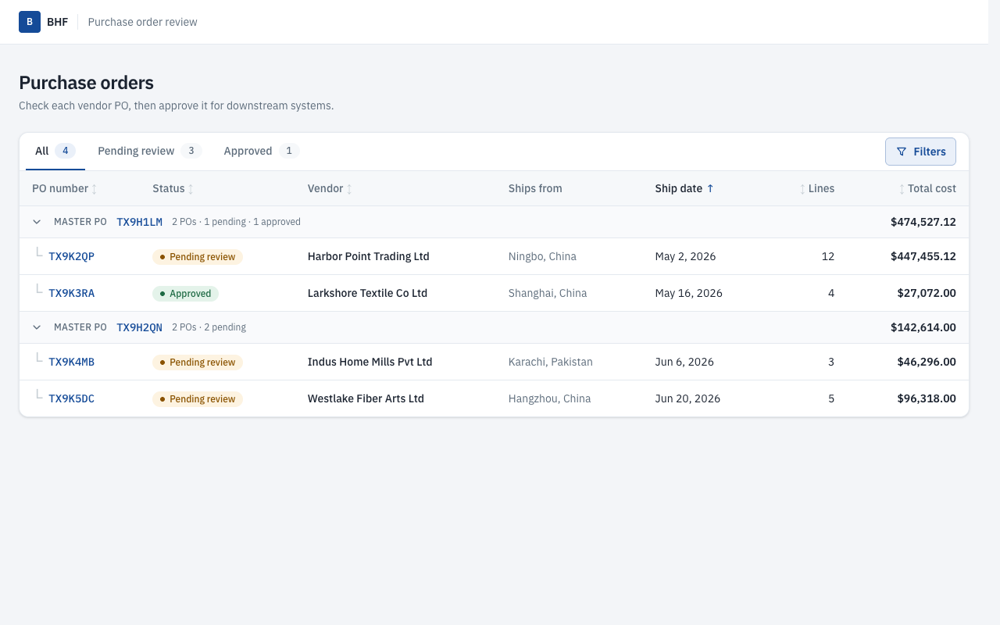
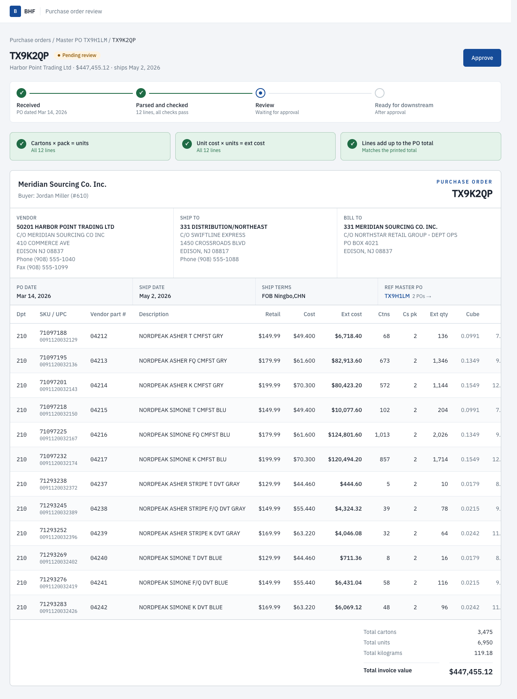
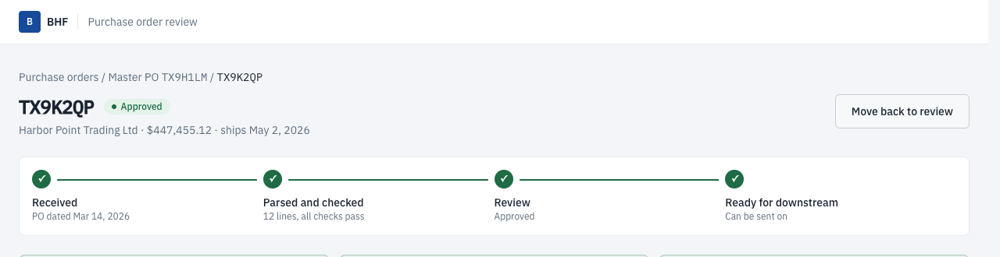
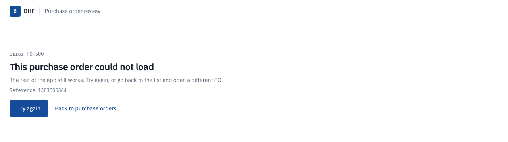
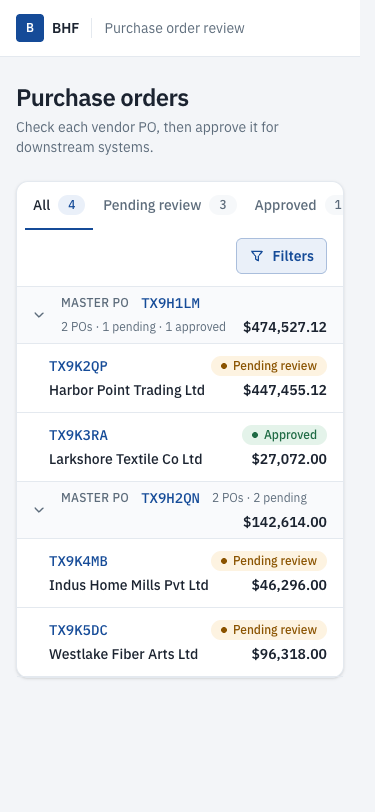
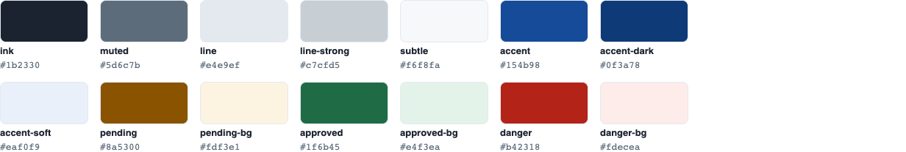

# PO Review (Next.js assessment)

A small internal dashboard for reviewing vendor purchase orders. The list of POs is rendered on the server. Each PO has a detail page with its line items and where it is in the review flow. A server action approves a PO or moves it back to review.



| PO detail | Approved | Phone |
|---|---|---|
|  |   |  |

## Run it

Requires Node 20 or newer. Built and tested on Node 26; CI runs on Node 22.

```bash
npm install
npm run dev          # http://localhost:3000
npm run dev:slow     # same, with 1.2 s simulated latency so loading states are visible
```

Production build:

```bash
npm run build && npm start
```

Checks:

```bash
npm run lint
npx tsc --noEmit
npm test             # Vitest unit tests for lib/
npx playwright install chromium   # first time only (or prefix the next line with PW_CHANNEL=chrome to use installed Chrome)
npm run test:e2e     # Playwright: builds, starts on :3100, runs desktop + 375px phone
npm run screenshots  # regenerates the images in ../docs/screenshots
```

## The brief, and where each part is

| Requirement | Where | What it does |
|---|---|---|
| Next 15, App Router, TypeScript, Tailwind | `package.json`, `app/` | Next 15.5, React 19, Tailwind v4. |
| Server-rendered list | `app/page.tsx` → `components/OrdersTable.tsx` | Async Server Components read the POs from `lib/orders.ts`. No client-side fetching; the data is in the HTML. |
| Dynamic route | `app/orders/[poNumber]/page.tsx` → `components/OrderDetail.tsx` | One PO: header, addresses, every line item with SKU, UPC and totals. Unknown PO numbers call `notFound()` and return a real 404. |
| Server action | `app/actions.ts` | `setReviewStatus` moves a PO between **Pending review** and **Approved**. The button sends the status it wants; the action checks the PO and the status, saves it, and revalidates the list and the detail page. |
| README | this file | How to run, what the action and route do, assumptions, time spent. |

## Beyond the brief

Everything below is extra. The brief's five requirements are complete without it.

- **Animated review flow.** `components/ReviewPanel.tsx` uses `useOptimistic`, so clicking Approve updates the badge, the button and the step tracker immediately. The connector line fills in and the check mark pops while the action runs. If saving fails, React restores the old status and the error appears under the button.
- **List page built around faceted filtering.** Status (All / Pending review / Approved) is a filter shown as tabs. The **Filters** button opens origin, vendor and master PO checkbox groups with Select all and Clear. Each tick applies at once; values in one group combine with OR, groups combine with AND. Each group only offers values that would return POs, given the other filters and the tab, with live counts, so there are no dead ends (`lib/filters.ts`). Active filters show as removable chips, with Clear all. Everything is in the URL, so every view is a shareable link.
- **Hierarchy: master PO → PO.** The table groups POs under their master PO (the printed "REF MASTER PO#"). Each group shows its PO count, statuses and total value, and can be collapsed. The PO page breadcrumb follows the same path, and "Ref master PO" on the document opens the list filtered to that master.
- **Sortable table.** Click any header; sorting runs on the server from the URL. The whole row opens the PO. An empty filter result shows a friendly animated message ("No POs waiting for review. All caught up.").
- **Detail page: the review on top, the PO as a document below.** Top: PO number, status, Approve button and step tracker, then three green/red checks that mirror the Python validator (cartons × pack = units, unit cost × units = ext cost, lines add up to the printed total; `lib/checks.ts`). Below: the purchase order laid out like the printed one a buyer or vendor knows: issuer and "PURCHASE ORDER" header, Vendor / Ship to / Bill to blocks, a terms strip (PO date, ship date, ship terms, ref master PO), the line items in the PO's own column order, and totals at the bottom right ending in the total invoice value. Names are title-cased and phone numbers formatted.
- **Only what changes reloads.** The toolbar and the table are separate `<Suspense>` parts; only the table is keyed by the filters and sort, so changing them reloads only the rows. React's `cache()` makes them share one data read per request.
- **Loading states.** The heading renders at once and each part streams in behind an animated skeleton (`components/Skeletons.tsx`).
- **Errors with codes.** Every error a person can see has a code and a plain message in `lib/errors.ts`, e.g. *PO-404 PO not found*, *PO-400 Status not recognised*, *PO-501 Status not saved*. Three error boundaries: the root layout (`global-error.tsx`), any page (`error.tsx`) and one PO (`orders/[poNumber]/error.tsx`). In production Next hides the real message, so the page also shows Next's error reference, which matches the server log.
- **Design system.** Shared tokens and five small UI pieces (below).
- **Tests and CI.** Vitest, Playwright on desktop and phone, and a GitHub Actions workflow.

## Design system

The look is a plain product dashboard: white cards, hairline borders, IBM Plex Sans, and IBM Plex Mono for codes (PO numbers, SKUs, UPCs). The one accent is the slate blue from Britannica Home Fashions' site, britannicahome.com.



All colors are `@theme` tokens in `app/globals.css`, so Tailwind classes like `text-muted` or `bg-pending-bg` use them. The image above is generated from those tokens by `npm run screenshots`.

| Text on background | Contrast (WCAG AA needs 4.5) |
|---|---|
| ink on white | 15.8 |
| muted on white / on subtle | 5.4 / 5.1 |
| accent on white, white on accent | 8.4 |
| pending on pending-bg | 5.8 |
| approved on approved-bg | 5.6 |
| danger on white | 6.6 |

UI pieces in `components/ui/`, used everywhere instead of one-off styles:

| Piece | Used for |
|---|---|
| `Button`, `linkClass` | Approve / Move back, Try again, text links. 44 px tall, visible focus ring. While saving it shows a spinner and ignores clicks but keeps keyboard focus. |
| `Badge` | Status pills (pending, approved) and tab counts (accent, neutral). Color changes fade. |
| `Card` | Stat cards, order details, address blocks. |
| `Th`, `Td` | Every table cell: one padding rule, numbers right-aligned with tabular digits. |
| `Spinner` | Button and tab loading indicators. |

Motion is short (200–500 ms) and every animation is wrapped in `motion-safe:`, so it is off for people who ask their system for reduced motion.

**Measured** with Lighthouse on the production build: `/` scores Performance 98, Accessibility 100, Best Practices 100; `/orders/TX9K2QP` scores 97, 100, 100. First Load JS is about 120 kB per page, most of it Next.js and React themselves.

## File map

```
app/
  layout.tsx                    fonts, header
  globals.css                   color, font and motion tokens
  page.tsx                      list page: heading + two <Suspense> parts
  actions.ts                    "use server" setReviewStatus
  error.tsx, global-error.tsx   error boundaries
  orders/[poNumber]/
    page.tsx                    404 check, breadcrumb + <Suspense>
    not-found.tsx               PO-404
    error.tsx                   PO-500
components/
  ui/                           Button, Badge, Card, Th/Td, Spinner
  OrdersToolbar.tsx             tabs + Filters menu with facet counts (server)
  FiltersMenu.tsx               the Filters panel and chips (client)
  MasterGroup.tsx               collapsible master PO group (client)
  OrdersTable.tsx               rows for the current filter (server)
  StatusTabs.tsx                status tabs with instant highlight (client)
  OrderDetail.tsx               review panel + checks + PO document (server)
  ReviewChecks.tsx              the three pass/fail checks
  PurchaseOrderDocument.tsx     the PO laid out like the printed document
  ReviewPanel.tsx               title, badge, button, step tracker (client, optimistic)
  ProcessSteps.tsx              Received → … → Ready for downstream
  Skeletons.tsx                 loading placeholders
  StatusBadge.tsx, ErrorCard.tsx, ErrorState.tsx
lib/
  types.ts                      Order, LineItem, ReviewStatus
  orders.ts                     the only module that reads or changes data
  errors.ts                     error codes and messages
  checks.ts                     the review checks (same rules as the Python validator)
  filters.ts                    status + facets: URL parsing, matching, facet options
  sort.ts                       sortable columns and list URLs
  origin.ts                     port and country from the ship terms
  format.ts                     money, dates, totals
data/orders.json                seed data
e2e/                            Playwright tests and the screenshot script
```

## Data

`data/orders.json` holds four POs.

- **TX9K2QP** is the real sample PO from the Python assessment. It was produced by `python-po-parser/po_extract.py --json` and copied here unchanged.
- **TX9K3RA, TX9K4MB, TX9K5DC** are made up, with invented vendors and brands, so the list has something to compare. Their line math is consistent (cartons × case pack = quantity, cost × quantity = extended cost).

## Assumptions

- **Status is kept in memory.** It starts from the JSON file and lives in a `Map` on `globalThis`, so it survives hot reloads in dev but **resets when the server restarts**. With several serverless instances (e.g. Vercel) each would have its own copy. A database would replace `lib/orders.ts` and nothing else.
- **Pages render on every request** (`dynamic = "force-dynamic"`) because status changes at runtime. Without it, Next prerenders `/` at build time and the new status would not show.
- **No authentication.** Anyone who can open the app can approve a PO.
- **The action sets a status; it never flips one.** The form sends `status=approved` or `status=pending`, so it is idempotent: clicking twice, clicking from an out-of-date tab, or two reviewers at once can't turn an approval back into "pending". The last write wins; a real system would also check a version number.
- **The status applies to the whole PO.** Approving individual lines was out of scope.
- **Light theme only.**
- **Skeletons use `<Suspense>`, not `loading.tsx`.** A `loading.tsx` streams the response with status 200 before the page runs, which turned the unknown-PO page into a 200 instead of a 404 (an e2e test caught this). The detail page checks the PO exists before anything streams.
- **Known `npm audit` advisories, all in tools that never reach the browser or the server at runtime:**
  - `postcss` inside Next.js 15: build-time only; the only fix is Next 16, which the brief rules out.
  - `eslint-config-next` → `micromatch`/`braces`: lint-time only; the suggested "fix" downgrades to Next 14's config.
  - `vitest`: affects its UI server and browser mode, which this project doesn't use; the fix is Vitest 5, which conflicts with the Node 20 types.
  - `@playwright/test` was upgraded to 1.55.1 to clear its advisory.
- **Two test-only switches** in `lib/orders.ts`, both off by default: `SIMULATED_LATENCY_MS` (used by `npm run dev:slow`) and `FAIL_PO` (Playwright sets it so one PO fails to load and the error boundary can be tested).

## Tests

- **Unit (Vitest, 30 tests):** order lookup and sort order, unknown PO, set both ways, setting is idempotent, a change affects only one PO, an unknown PO is rejected and nothing changes, only the two real statuses are accepted, every PO's lines add up to its total, the seed data has every field with the right type and no duplicate PO numbers, money, date, percent, phone and name formatting, and each review check catching a tampered line.
- **Malformed input to the server action (Vitest, in the 30):** no fields, an unknown PO, a path in the PO number, a file instead of text, a missing status, an unknown status, the wrong case, and a script tag. Each returns PO-404 or PO-400 and changes nothing.
- **End to end (Playwright, 10 tests × desktop and 375 px phone):** the raw HTML already contains the PO data (server rendering); list → detail shows 12 lines and $447,455.12; Approve → status changes, survives reload, approved count goes up, then moves back; approving from an out-of-date second tab keeps the PO approved; the step tracker moves to "Can be sent on" and back; tabs filter the list; `/orders/NOPE` returns 404 with code PO-404; a PO that fails to load shows the PO-500 error page with a working link back; no sideways page scroll.

## With more time

- Persist status in SQLite or Postgres, and record who approved and when.
- Search by PO number or vendor.
- Show the Python validation flags on the detail page.
- Sign-in, so approvals are tied to a person.

## Time spent

About 1 hour in total for both parts, working with Claude Code. See the [root README](../README.md).

## AI use

Built with Claude Code. Its instruction files are committed unchanged: [`../CLAUDE.md`](../CLAUDE.md) and [`CLAUDE.md`](CLAUDE.md).
